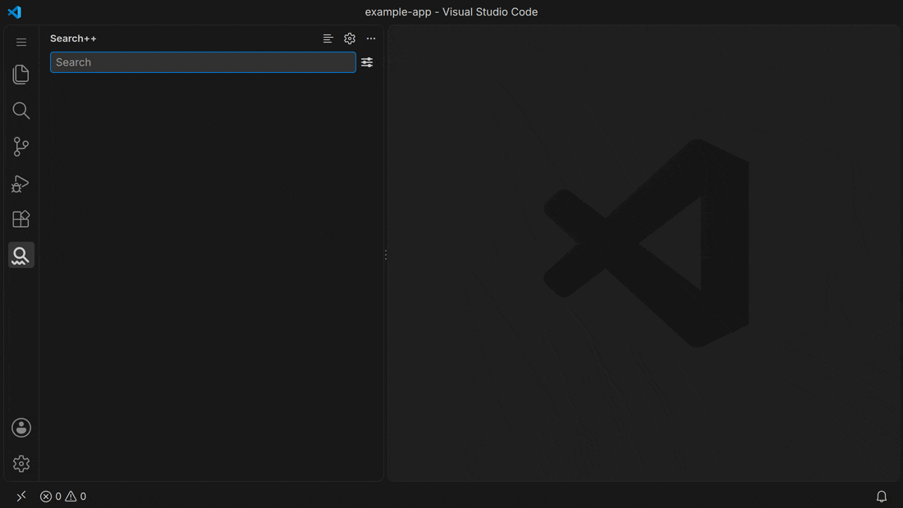
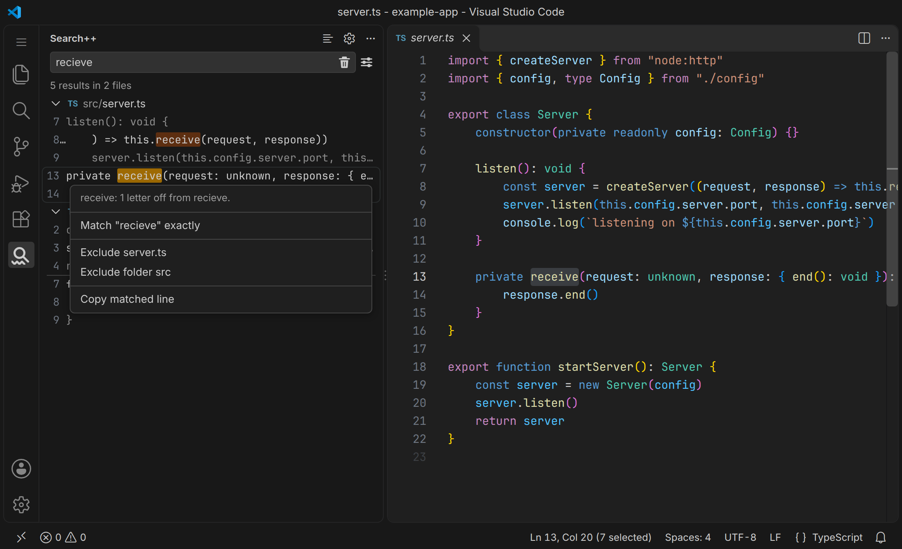
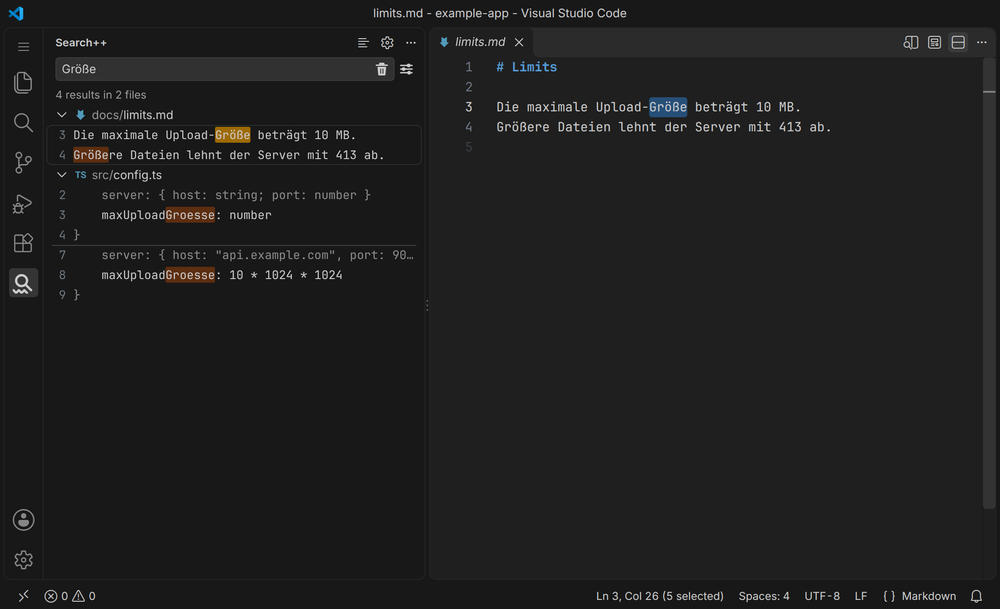
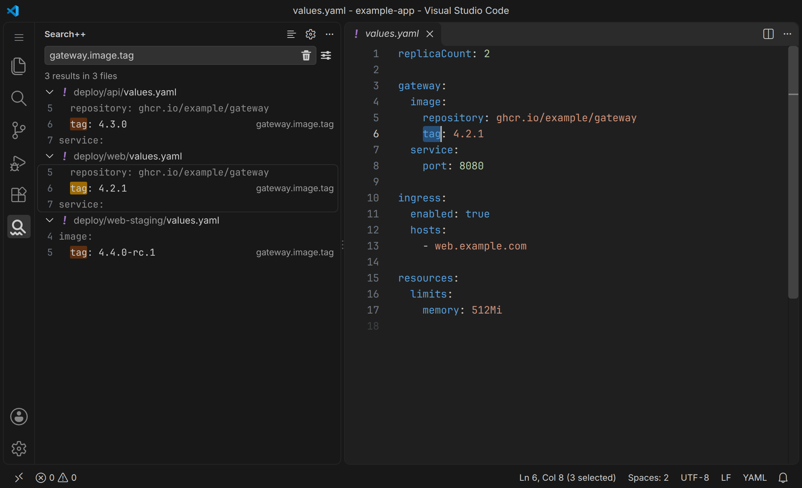
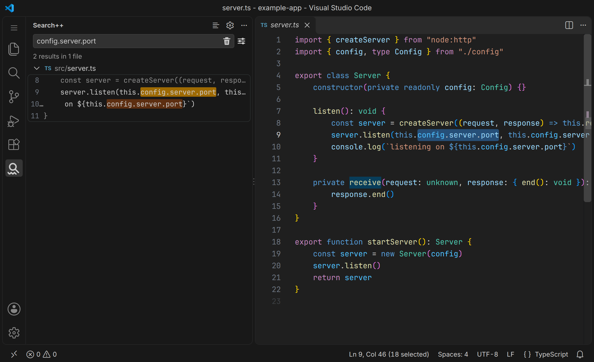
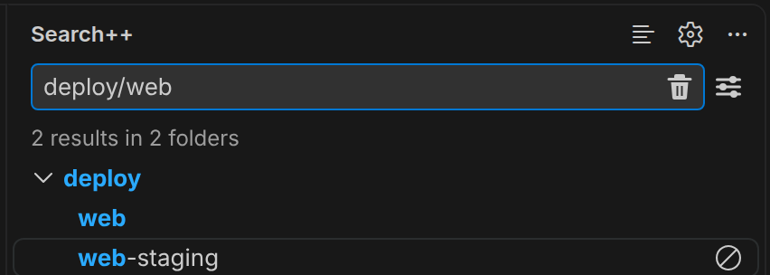

<h1 align="center">Search++</h1>

Workspace search for VS Code that finds what you meant: typos, umlauts and dotted keys included.

  
  
  

## Typos match

`recieve` finds `receive`.
The context menu says why.

## Umlauts match both ways

`Größe` finds `Größere` and `maxUploadGroesse`.

## Keys by their path

`gateway.image.tag` finds the `tag` key in YAML, JSON and TOML files.

## Member chains

`config.server.port` finds `this.config.server.port` in TypeScript and JavaScript.

## Files and folders by name

`deploy/web` finds the folders `web` and `web-staging`.

## Cheat sheet

| Query            | Finds                                    |
| ---------------- | ---------------------------------------- |
| `grav`           | `Gravitee`, in any case and inside words |
| `"Größe"`        | `Größe` alone                            |
| `console.log(*)` | every call of `console.log`              |
| `**.enabled`     | every `enabled` key at any depth         |
| `/4\.\d+\.\d+/`  | version numbers, as a regex              |

The [reference](docs/reference.md) lists the whole query language, the settings and the Ctrl+Shift+F binding.

## Install and use

Install [Search++ from the Marketplace](https://marketplace.visualstudio.com/items?itemName=bjoern621.searchplusplus), then press Ctrl+Shift+F (Cmd+Shift+F on macOS).
Selected text in the editor goes into the query.
Replace stays with the built-in Search view.
Search++ needs VS Code 1.100 or later.

Other extensions add search engines through the [API](API.md).

[MIT](LICENSE)
